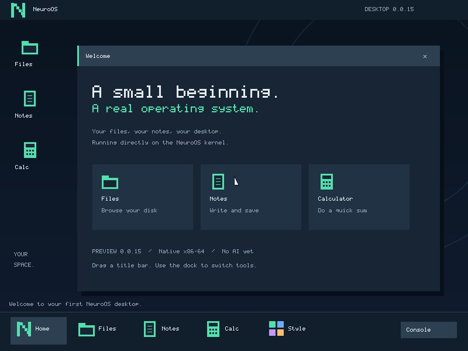
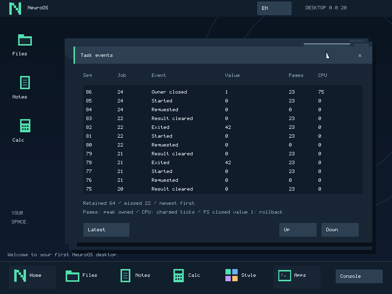
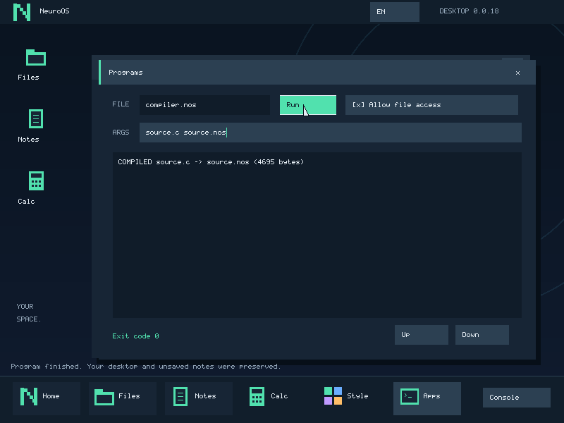
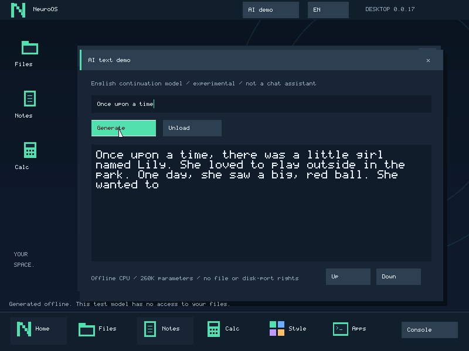

# NeuroOS — системная основа и рабочий стол

Проверенный билд — v0.0.20 с фоновыми .nos, файловыми сессиями и просмотром событий. Приоритет от 2026-11-04:
сначала ОС и универсальные средства управления, интеграция ИИ — в последнюю
очередь. Процессы, права, события и API сервисов готовятся заранее и проверяются
без моделей. План и состояние — [docs/system-control.md](docs/system-control.md).



Рабочий стол: мышь, окна, файлы, заметки UTF-8 с русским вводом, калькулятор,
цвет интерфейса и запуск собственных .nos с выводом результата. Есть выделение,
внутренний буфер обмена и отмена правок. C-файл можно выбрать в Files и собрать
кнопкой Build C, затем запустить результат. Заметки и настройки сохраняются на диск.
Интерфейс пока английский. Окна инструментов живут в одном desktop-процессе,
запущенная программа и файловый сервис изолированы. Одна обычная .nos выполняется
в фоне: можно редактировать и сохранять заметки, пока программа работает.
Programs показывает вывод и Stop. Сбой/CPU-лимит/отмена освобождают ресурсы ребёнка;
файловая транзакция закрывается отдельно. Загрузка самого ELF пока синхронная.
Контракт и ограничения — [docs/jobs.md](docs/jobs.md).

Programs → Events показывает запуск и завершение задач, Stop, rollback файловой
сессии и восстановление сервиса, наблюдённые страницы и CPU ticks. Журнал хранит
64 последние записи в RAM, обнаруживает потерю старых событий и переживает
перезапуск desktop до перезагрузки ОС. Это первый ограниченный read-only интерфейс
наблюдения; полный постоянный аудит и права подписок впереди.
Формат и проверки — [docs/events.md](docs/events.md).



Собственное минимальное ядро x86-64: загрузка UEFI → Limine → ядро,
диагностика COM1 и экранная оболочка. Ядер других ОС внутри нет.
Работают собственные GDT/IDT/TSS, исключения, физический аллокатор, начальная куча,
собственные таблицы страниц, таймер и ввод с виртуальной клавиатуры.
Есть изолированные ring-3 задачи, вытеснение по таймеру, проверка прав IPC и загрузка
внешних ELF-программ: файлового сервиса, его клиента и приложений C. Диагностическая оболочка
пока находится в ядре. Есть экспериментальный изолированный CPU runtime: учебная модель продолжает
английские истории офлайн. Системный помощник и Agent Manager ещё не реализованы.



## Сохранённый экспериментальный AI demo

Прототип v0.0.17–18 остаётся optional; его развитие отложено до готовности
системной основы. Это не окончательный API управления ОС.



В optional-сборке с отдельным флагом есть AI demo: вычисление маленького трансформера
на CPU, через отдельный пользовательский сервис и IPC. Он генерирует продолжение
английского текста и не получает доступа к файлам или портам диска. Модель учебная,
финальный выбор основного помощника ОС впереди. Веса optional и закреплены хешами.

Генерация работает в фоне: можно редактировать и сохранять Notes, открывать Files
и менять настройки. Cancel останавливает вычисление и освобождает память, Unload
выгружает кэш модели. Ctrl+Alt+G запускает генерацию текущего AI prompt из любого
окна. Обычный native job и этот optional прототип пока взаимоисключающие;
перед запуском .nos нужно закончить или отменить генерацию.

Установка тестовых весов и включение AI в сборке:

```powershell
python scripts/setup-ai-demo.py
$env:NEUROOS_AI_DEMO='1'
```

Затем соберите ISO обычной командой ниже. После первоначального получения весов
сборка/запуск работают без сети. Без флага веса для обычной сборки не нужны.
Архитектура, лицензии и ограничения — [docs/ai-demo.md](docs/ai-demo.md).

## Прямой запуск в VMware Workstation

Для нового checkout сначала выполните `python scripts/setup-vm.py`.
Готовая машина: `vmware/NeuroOS.vmx`. Откройте этот файл в Workstation и
включите питание. Она загружает нашу ОС напрямую с `build/NeuroOS.iso`:
UEFI, 256 МиБ памяти, один CPU, без сети, с виртуальным диском 64 МиБ.
Ядро загружается с ISO; данные хранятся в vmware/data-flat.vmdk. Установщика ОС пока нет.
Для нового checkout при выключенной машине: `python scripts/setup-vm.py`, затем
сборка ISO по инструкции ниже. Существующие конфигурация и диск сохраняются.

После загрузки ISO открывается рабочий стол. Щёлкните внутри виртуальной машины,
откройте Notes, измените текст и нажмите Save. Имя файла редактируется в поле FILE.
RU/EN переключается кнопкой в верхней панели или Alt+Shift. Ctrl+S сохраняет,
Ctrl+L переводит в поле имени (имена файлов пока латиницей), Tab в тексте вставляет
четыре пробела. Shift+стрелки выделяют, Ctrl+A/C/X/V работают внутри Notes,
Ctrl+Z/Y отменяют/возвращают правки. Home/End, Delete, PageUp/PageDown поддерживаются.
Кнопка + в заголовке разворачивает заметки. Files: выберите строку и Open / Run.
Для C-файла есть Build C: проверьте аргументы компилятора, разрешите доступ к файлам
и нажмите Run. Apps показывает вывод программ; файловые права по умолчанию выключены.
Во время работы Run становится Stop. Поля запуска и права зафиксированы до завершения;
они не изображают отзыв прав у уже работающей программы. Если ребёнок держит
транзакцию, Save сообщает о занятости и сохраняет текст в редакторе; повторите
сохранение после завершения/отмены записи.
Смена цвета — Style в нижней панели. Console возвращает диагностическую оболочку,
команда `desktop` снова открывает графический интерфейс. Для освобождения захвата
мыши и клавиатуры — Ctrl+Alt.

В консоли введите `help`. Раскладка US, Shift и CapsLock поддерживаются. Шрифт
различает регистр и показывает знаки C/C++. Диагностическая консоль пока поддерживает только ASCII.
В ожидании ввода CPU выполняет `sti; hlt` и просыпается от таймера; прежнего
уведомления CPU disabled при обычной загрузке больше не должно быть.
Команда `halt` намеренно останавливает CPU, после неё нужен перезапуск машины.
Журнал ядра: `vmware/serial.log`.
Если при повторном запуске предлагается действие для существующего serial.log,
выберите добавление или замену журнала, иначе serial-порт может остаться отключённым.

| Команда | Действие |
|---|---|
| `help`, `info` | Справка и состояние реализации |
| `desktop` | Открыть графический рабочий стол |
| `mem` | Счётчики свободных страниц и байтов кучи |
| `alloc 2` | Выделить две физические страницы, получить ID |
| `heap 128` | Выделить 128 байтов в куче, получить ID |
| `free 0` | Освободить выделение с указанным ID |
| `test` | Записать/прочитать память, проверить отображение страницы и освобождение |
| `proctest` | Запустить девять изолированных задач, проверить IPC и локализацию ошибок |
| `fstest` | Запустить отдельную тестовую пару файлового сервиса/клиента |
| `recoverytest` | Намеренно завершить файловый процесс и восстановить сервис с диска |
| `touch note` | Создать файл в пользовательском файловом сервисе |
| `write note hello` | Заменить содержимое файла ASCII-текстом |
| `cat note`, `stat note`, `ls`, `rm note` | Прочитать / размер / список / удалить |
| `install hello.nos`, `install filedemo.nos` | Скопировать пример программы с загрузочного образа |
| `run hello.nos аргументы` | Запустить программу без доступа к файловому сервису |
| `runfs filedemo.nos` | Запустить программу с доступом к файловому сервису |
| `edit source.c` | Построчно редактировать файл; `.save`, `.cancel`, `.clear` |
| `cc source.c output.nos` | Скомпилировать C или GNU ASM внутри NeuroOS |
| `install-sdk` | Установить заголовки и статическую библиотеку C |
| `uptime` | Тики аппаратного таймера, примерно 100 в секунду |
| `echo текст`, `clear` | Вывести ASCII-текст / очистить экран |
| `halt` | Остановить CPU до перезапуска |

Есть 16 слотов выделений. Длина команды — до 95 символов; переполнение строки
отклоняется целиком. Выделения памяти исчезают после выключения.
Файловый сервис хранит до 128 файлов размером до 1 МиБ каждый,
имена — до 15 ASCII-символов, без каталогов. Файлы доступны между командами и
переживают proctest/fstest. При наличии виртуального ATA-диска сохраняются
после перезагрузки; без диска сервис сообщает о работе в RAM-режиме.

Пример интерактивной проверки:

```text
write note hello from neuroos
cat note
ls
proctest
cat note
rm note
```

Для обновления образа сначала полностью выключите эту виртуальную машину,
затем выполните из корня проекта:

```powershell
# Требуется один раз, в текущей копии уже выполнено:
python -m pip install --target tools/python pycdlib==1.14.0
python scripts/make_iso.py
```

Создание ISO после установки зависимости работает офлайн. Образ содержит обычное
ядро, EFI-загрузчик, его конфигурацию, файловый сервис, клиент, примеры программ
и compiler.nos. В настроенном desktop-bootstrap при отсутствии одноимённых файлов
также устанавливаются hello.nos и compiler.nos; существующие файлы не заменяются.
Команда cc использует загрузочный модуль; компилятор также можно
установить и запускать с диска данных: install compiler.nos, затем
runfs compiler.nos source.c output.nos.
Скрипт проверяет извлечённые из образа исполняемые файлы
и тип загрузочной записи, затем сохраняет SHA-256 рядом с ISO.
Ограничение: метаданные времени ISO пока не нормализованы, его побайтовая
воспроизводимость не заявляется. Для исходной сборки ядра правила прежние.

## Быстрый старт

Исполняемые файлы имеют расширение `.nos`, внутри — статический ELF64 с локальным
ABI: e_ident[7]=0x4e, e_ident[8]=1. Это метка совместимости, а не цифровая подпись.

```text
install hello.nos
run hello.nos first
```

После перезагрузки повторите `run hello.nos reboot`. Программа напечатает аргумент
и вернёт EXIT CODE 42. install не перезаписывает существующий файл. Образец собран
из user/hello.c компилятором хоста, а не внутри гостевой ОС. run загружает байты с
диска в новый ring-3 процесс. Поддержаны строка аргументов до 79 символов, возврат
кода завершения и освобождение памяти. Пока нет argc/argv, окружения и фонового запуска.
Файлы ограничены 1 МиБ; hello.nos использует один RX-сегмент вместе с ELF-заголовком.
Сам загрузчик пока ограничивает сумму ELF-сегментов 160 страницами.

`filedemo.nos` проверяет библиотеку C и вычисления double. Обычный `run` завершает
его с кодом 13: файловые права не выданы. `runfs filedemo.nos` создаёт app.txt,
читает его обратно и возвращает код 0. Доступ к ATA-портам приложению не выдаётся.
Аргумент `heap` проверяет malloc/calloc/realloc/free, `test` — файловые потоки.
Аргументы `crash`, `nx`, `shrink`, `die` намеренно вызывают локализованный сбой.
При падении клиента незавершённая файловая транзакция отменяется.

В user/heap.c реализован начальный аллокатор C, в user/stdio.c — fopen/fclose,
fread/fwrite, fseek/ftell, EOF/error, ungetc и базовый посимвольный/строковый ввод-вывод.
Потоки файлов работают без буферизации, успешная запись фиксируется сервисом.
До восьми открытых файлов на процесс, один поток исполнения, без POSIX-совместимости,
каталогов, scanf и чтения stdin. printf/snprintf поддерживают целые числа, строки,
ширину/точность; дробные и широкие преобразования отклоняются. Есть strto*-преобразования,
строки, qsort, setjmp/longjmp, начальный адаптер open/read/write/lseek/fdopen.
stdout/stderr выводят через системный вызов. Подробности — docs/toolchain-port.md.

## Нативная компиляция

```text
write demo.c int main(void) { return 42; }
cc demo.c demo.nos
run demo.nos
```

Ожидаются COMPILED и EXIT CODE 42. Для нескольких строк используйте edit demo.c,
завершите .save. Работают структуры, массивы, циклы, глобальные данные, double,
GNU inline ASM и отдельный .s с символом main. Поддерживаются main(void) и
main(const char *arguments); argc/argv ещё нет. При ошибке компиляции или несовместимом
с загрузчиком результате прежний выходной файл сохраняется. Нужны свободные места
для временного и выходного файлов.

compiler.nos — порт закреплённого TinyCC, выполняется в ring 3 с правами файлового
клиента. В госте компилируется программа; сам компилятор пока собирается LLVM на хосте.
Встроены свой startup и минимальные memcpy/memset/memmove/memcmp. Для библиотек
выполните install-sdk: заголовки и libnos.a станут доступны компилятору из корня
файлового сервиса. Это начальный freestanding SDK, не полный ISO C/POSIX runtime.
C++ пока не поддерживается. __DATE__/__TIME__ намеренно соответствуют
фиксированной эпохе 1970-01-01 00:00:00 UTC, пока нет гостевых настенных часов.
Изменения порта воспроизводит ports/tinycc/prepare.py; исходники и лицензии сохранены
в vendor/tinycc и vendor/musl-1.2.5, хеши проверяются при сборке.

## Библиотека и заголовки SDK

install-sdk устанавливает 21 файл одной транзакцией: libnos.a, заголовки и лицензии
зависимостей. Существующие одноимённые файлы не заменяются; при конфликте установка
останавливается до записи. SDK сохраняется между загрузками. Архив собирается
LLVM на хосте; нативный компилятор линкует его ELF-объекты к новой программе в госте.
Для автоматической первичной установки предусмотрен NEUROOS_BOOTSTRAP_SDK=1 при
сборке. Он устанавливает SDK только при отсутствии libnos.a и не заменяет существующие
имена; повторная загрузка пропускает установку. Режим отражён в build.json.

Доступны stdio/string/stdlib/errno, setjmp, целочисленные типы, ограничения,
varargs, базовые open/read/write/lseek и neuro.h. Например, через edit demo.c:

```c
#include <stdio.h>
int main(void) {
    printf("Hello from native C!\n");
    return 42;
}
```

После .save: cc demo.c demo.nos, затем run demo.nos. Для nos_file_* из neuro.h
нужен запуск runfs demo.nos. Обычный run оставляет программу без файловых прав.
Проверены malloc/free, printf, strtod и запись/чтение файла в программе, полностью
скомпилированной и слинкованной внутри ОС, в том числе после холодной загрузки.
Полная libc, scanf, чтение stdin, atexit, локали и многопоточность пока отсутствуют.

## Хранилище v3

На отдельном виртуальном диске 64 МиБ находятся два корня по 8192 байта и
copy-on-write extents по 4096 байтов. При изменении файла записывается новый extent,
затем после flush переключается корень. Старые банки v1/v2 не перезаписываются;
проверенные прежние файлы импортируются при первой загрузке. Marker запрещает
незаметный возврат к старому v2 после повреждения обоих новых корней.

Ёмкость данных — около 63 МиБ; 1 МиБ — максимум отдельного файла, 128 — максимум
числа имён. Для перезаписи требуется свободное место под новую копию, ссылки обоих
корней учитываются аллокатором. CRC проверяет метаданные и данные при первом чтении.
При IO-ошибке сервис прекращает работу; поддержка физических ATA-дисков не заявляется.
Политика рассчитана на созданный для проекта виртуальный диск. Без него RAM-режим
предназначен для диагностики и сохраняет старый лимит восьми файлов по 16 КиБ.
Построчный редактор пока ограничен 16 КиБ, даже когда сам файл может быть крупнее.

Из корня проекта, в PowerShell:

```powershell
python scripts/neuro.py build
python scripts/neuro.py test
```

Успешный тест выводит `PASS`, возвращает код 0 и сохраняет результаты в
`build/test/test-result.json`. Точный маркер в UTF-8:

```text
NeuroOS v0.0.14 — Kernel boot successful
```

Тест требует одновременно маркер, `Firmware: UEFI64`, подтверждение таблиц CPU,
ненулевой объём доступной памяти в пределах RAM гостя и код завершения
гостевого эмулятора 33. Проверка ограничена 45 секундами, старый serial-лог
очищается перед запуском. При ошибке команда возвращает ненулевой код.
Полные журналы: `build/test/serial.log`, `qemu.stdout.log`, `qemu.stderr.log`.
Это boot smoke test: он не проверяет ещё отсутствующие подсистемы ОС.

Обычная сборка не обращается к тестовому порту завершения эмулятора:

```powershell
python scripts/neuro.py run
```

Запуск без графического окна; ядро остаётся в оболочке.
Остановить эмулятор можно Ctrl+C. Читать лог из другого терминала:

```powershell
Get-Content build/normal/serial.log -Encoding utf8 -Wait
```

## Инструменты и офлайн-работа

Проверенная среда: Python 3.12, LLVM/Clang и LLD 21.1.8, Windows x64.
Python используется как простая система сборки без сторонних пакетов.
Clang собирает ELF для `x86_64-unknown-none-elf`, а не приложение Windows.
Компилятор ищется в PATH и `C:\Program Files\LLVM\bin`.

Эмулятор в текущем рабочем проекте уже распакован в `tools/qemu`.
Для нового клона подготовить его можно командой:

```powershell
powershell -ExecutionPolicy Bypass -File scripts/setup-qemu.ps1
```

Подготовка требует сеть и 7-Zip; архив проверяется по закреплённому SHA-512.
Установщик не запускается: файлы распаковываются только в проект.
Требуется примерно 1.5 ГБ свободного места. Для офлайн-подготовки заранее
перенесите архив из URL в `dependencies.lock.json` в `tools/downloads/qemu.exe`.
После подготовки `build`, `test` и `run` сеть не используют.
Для полностью автономного восстановления сохраните также установщики Python,
LLVM и 7-Zip: они в репозиторий не включены.

Можно задать абсолютные пути через переменные окружения:
`CLANG`, `LD_LLD`, `QEMU`, `OVMF_CODE`, `OVMF_VARS`.
Файлы OVMF_CODE и OVMF_VARS должны быть совместимой парой.
По умолчанию используется прошивка EDK II/OVMF из комплекта эмулятора:
`share/edk2-x86_64-code.fd` и `share/edk2-i386-vars.fd`.
Шаблон переменных копируется в build перед каждым запуском.

Параметры гостя: q35, программная эмуляция TCG, один CPU, 256 МиБ RAM,
сеть выключена. Папка ESP подключена как виртуальный FAT-диск только для чтения
через virtio-blk. Доступ к физическим дискам не нужен.

```powershell
python scripts/neuro.py test --timeout 30 --memory 128
```

## Структура и решения

- `kernel/main.c`: запрос версии протокола и типа прошивки, COM1, точка входа.
- `kernel/memory.c`: проверка диапазонов карты памяти, подсчёт только USABLE.
- `kernel/alloc.c`: физические страницы и начальная куча с объединением свободных блоков.
- `kernel/paging.c`: копирование дерева таблиц загрузчика, переключение CR3,
  тест отображения/удаления страницы, пользовательские адресные пространства,
  безопасное копирование сообщений в/из пользовательской памяти.
- `kernel/process.c`, `kernel/entry.S`: сохранение контекста, ring 3, системные
  вызовы через int 0x80, временные сеансы планировщика, права и очереди сообщений.
- `kernel/elf.c`: строгая проверка ограниченного статического ELF64 ABI.
- `user/ramfs.c`, `user/fs.c`: файловый сервис в пользовательском пространстве.
- `user/fsclient.c`, `user/abi.h`: отдельный RPC-клиент и ABI системных вызовов.
- `kernel/files.c`: интерфейс команд оболочки, данные файлов здесь не хранятся.
- `kernel/devices.c`, `kernel/timer.S`: PIC/PIT, IRQ таймера, ввод PS/2.
- `kernel/shell.c`: диагностические команды, учёт выделений и ввод строк.
- `kernel/exceptions.c`: GDT, TSS, IDT; отдельные IST-стеки для #DF, NMI и #MC.
- `kernel/entry.S`: переключение GDT/CS и 256 входов обработчиков прерываний.
- `kernel/screen.h`: минимальный диагностический вывод через framebuffer
  загрузчика; при неподдерживаемом формате остаётся serial-диагностика.
- `kernel/linker.ld`: ELF-сегменты с раздельными правами RW/RX/R;
  адрес ядра начинается с `0xffffffff80000000`.
- `boot/limine.conf`: автоматическая загрузка ядра.
- `scripts/neuro.py`: проверка зависимостей, сборка, запуск и boot-тест.
- `scripts/make_iso.py`: упаковка обычной сборки для прямой загрузки с ISO.
- `vendor/limine`: закреплённый загрузчик, заголовок протокола и его лицензия.
- `dependencies.lock.json`: версия инструментов, commit и хеши зависимостей.
- `build/normal` и `build/test`: раздельные результаты обычной и тестовой сборки.

На этом этапе C11 достаточно; ASM используется только для инструкций ввода-вывода
и управления CPU. C++ можно добавить при появлении соответствующих компонентов.
Владелец выбрал собственную микроядерную архитектуру 2026-11-02;
решение и границы компонентов — в docs/architecture-decision.md. Готового ядра, libc,
планировщика и системных вызовов зависимости не предоставляют.
Стек, стартовые таблицы страниц и переход в long mode пока обеспечивает загрузчик.
Ядро заменяет GDT/IDT и загружает свой TSS. Таблицы страниц загрузчика копируются
в выделенные ядром страницы, CR3 переключается на собственный корень. Сами
отображения и их права пока сохранены; исходные таблицы не освобождаются.
Поддерживается четырёхуровневый paging, основное ядро остаётся на стеке загрузчика.
У пользовательских задач отсутствуют низкие отображения загрузчика; старшая
половина адресного пространства доступна только ядру. Код задачи RX, данные и
стек RW/NX; перед стеком есть неотображённая страница. Пользовательские адреса
проверяются по таблицам страниц, весь буфер приёма проверяется до первой записи.
Системный вызов 10 управляет отдельной кучей процесса: адрес 16 МиБ, до 512 страниц
(2 МиБ), RW/NX. Новые страницы обнуляются; неудачное расширение не меняет прежнюю
границу; уменьшение освобождает страницы. Все страницы возвращаются при завершении.
Произвольного mmap, разделяемой памяти и подкачки пока нет.
Стек внешней ELF-программы — 64 КиБ, нижняя защитная страница сохранена;
малые диагностические ASM-задачи отдельно используют стек 4 КиБ.

Временный ABI загрузчика программ: статический ELF64 x86-64 ET_EXEC, до 16
записей заголовков, не более 160 страниц сегментов, адреса 4..7 МиБ, выравнивание
начала сегмента по странице. W+X, динамическая линковка, TLS, пересекающиеся
страницы сегментов и исполняемый стек отклоняются. Память BSS обнуляется.
Системные службы загружаются как boot-модули; команда run запускает .nos из файлового сервиса.

Планировщик работает на одном CPU в рамках запущенного набора задач; оболочка
в ring 0 не вытесняется. В тестовом наборе девять слотов и лимит восемь тиков
user CPU на задачу; для файлового обмена — два слота и лимит 1000 тиков.
Файловый сервер сохраняет память и контекст между командами и получает CPU при
запросе. Запуск произвольных фоновых программ и управление процессами ещё впереди.
Состояние x87/MMX/XMM и MXCSR сохраняется FXSAVE64/FXRSTOR64 при переключениях
и входе в ядро. Новая задача получает чистое состояние. AVX/XSAVE не включаются.
Системные вызовы выполняются с выключенными IRQ и имеют ограниченный объём работы.

IPC: четыре слота прав на задачу, фиксированные endpoint-объекты, раздельные
Send/Receive, очереди по восемь сообщений до 64 байтов. Это начальная реализация
прав на объекты, без передачи/делегирования/отзыва capabilities и без файловых ACL.
Пустая/полная очередь возвращает ошибку для повторения с yield; блокирующего IPC пока нет.

Физический аллокатор учитывает только полные страницы USABLE; данные ядра,
загрузчика и firmware не выдаются. Метаданные рассчитаны на 64 ГиБ usable RAM
и до 4096 диапазонов. Куча занимает фиксированный физически непрерывный 1 МиБ,
возвращает 16-байтово выровненные блоки, объединяет свободные соседние блоки.
Выделение/освобождение рассчитано на один CPU, из IRQ не вызывается. PMM API
принимает адрес и число страниц, caller обязан освобождать свой исходный диапазон;
это пока не система прав владения памятью и не защита от повреждения heap-метаданных.

Логирование ограничивает число попыток опроса UART. При ошибке протокола ядро
пишет BOOT ERROR и останавливается. Исключение выводит номер, код ошибки, RIP,
CS, RFLAGS, RSP и CR2; затем ядро останавливается. CR2 имеет смысл для #PF.
Ошибка ядра фатальна; ошибка пользовательской задачи завершает эту задачу.
Разрешён только IRQ0 таймера. PS/2-клавиатура опрашивается после пробуждения
примерно каждые 10 мс; serial-ввод также поддерживается. Это драйверы виртуального
PC для текущих гипервизоров, универсальная поддержка реальных USB-клавиатур не заявляется.
Сборка включает строгие предупреждения и не использует red zone, hosted runtime,
stack protector или динамическую линковку. Ядро собирается без SIMD, программы
могут использовать x87/SSE. Полная защита от ошибок памяти не заявляется.

## Проверки и воспроизводимость

См. `docs/validation.md` для фактически выполненных проверок.
`build.json` сохраняет версии компилятора/линкера и SHA-256 ядра.
Нет времени сборки или случайного build ID; зависимости загрузчика проверяются
перед каждой сборкой. Для побайтового повторения используйте ту же версию LLVM.
Воспроизводимость между разными компиляторами и ОС хоста не заявляется.
Карту памяти проверяют 11 host-тестов, исполняющих настоящий C-код в DLL без CRT.
Для них нужен Windows x64 и lld-link (из LLVM; путь можно задать через LLD_LINK).
Аппаратные обработчики проверяются в эмуляторе:

```powershell
python tests/test_memory.py
python tests/test_alloc.py
python tests/test_services.py
python tests/test_shell.py
python scripts/neuro.py test --fault 6
python scripts/neuro.py test --fault 13
python scripts/neuro.py test --fault 8
python scripts/neuro.py test --fault 14
```

Это реальные #UD, #GP, #DF и #PF, а не прямые вызовы C-обработчика.
Первые два теста проверяют точный RIP инструкции и код ошибки. Третий нарушает
доставку #GP и проверяет, что #DF пришёл на выделенный IST-стек. Успех требует
`SELFTEST: exception PASS` и отдельный код завершения 37. Тестовые сбои не
включаются в обычное ядро или ISO. Логи каждого сценария находятся в build/fault-N.
Тест #PF проверяет адрес CR2 и RIP при чтении из отсутствующего отображения.
Прочие векторы пока не проходили отдельные fault-injection тесты.
test_alloc выполняет восемь host-тестов, включая случайные последовательности
выделений и проверку содержимого живых heap-блоков. test_shell загружает обычное
ядро и вводит команды через QMP-клавиатуру: проверяются обработка строки,
таймер, счётчики памяти, самопроверка и ошибки ввода; сохраняется shell.ppm.
Он также проверяет повторные proctest, fstest, файловые команды, сохранение
данных сервера и восстановление свободной памяти после завершения клиентов.
test_services выполняет 17 host-тестов ELF-валидатора и прежнего RAMFS/import-кода.

## История хранилища v1/v2 и дальнейшие задачи

Постоянное хранилище v0.0.6: ATA PIO в user/storage.c, доступ к портам первичного
IDE-канала через отдельное право объекта (slot 3), которое получает только рабочий
файловый сервер. Демонстрационные задачи и тестовый RAMFS этим правом не обладают.
Ядро проверяет порт/ширину операции; протокол ATA и формат хранения находятся вне ядра.
Диск используется без разделов, только в выделенной виртуальной машине.

Формат v2: два банка по 258 секторов начиная с LBA 64, поколение и CRC32.
Старый v1 импортируется; прежние 36 секторов не перезаписываются. Сектор 63
фиксирует переход на v2 и запрещает откат к устаревшему v1 при повреждении обеих новых копий.
Сначала сбрасываются данные неактивного банка, затем записывается commit-заголовок.
При старте выбирается последний корректный банк; ненулевое повреждённое хранилище
не форматируется. Нельзя считать это готовой журналируемой ФС: проверены холодная
перезагрузка и порча контрольной суммы одного банка, а не все варианты потери питания.
Команды write и install используют begin/commit/abort: промежуточные части
не сохраняются отдельными снимками; фиксируется только результат всей команды. При ошибке commit сервис завершается без
успешного ответа, чтобы не подтверждать несохранённые изменения.

В QEMU данные — build/normal/data.img; тесты не используют диск рабочей VMware.
Не удаляйте vmware/data-flat.vmdk при обновлении ядра — это пользовательские данные.
Прежний v2 ограничен восемью файлами по 16384 байта; рабочий v3 описан выше.

1. Автоматический надзор за сервисами и восстановление незавершённых запросов.
2. Расширение дискового формата, каталогов и размера файлов.
3. Общий менеджер пользовательских процессов и перенос консоли из ядра.

Нет универсальной дисковой файловой системы, графического интерфейса, AI Runtime
или драйверов реального оборудования. Загрузочный FAT обслуживает прошивка и
загрузчик; это не собственная файловая система ядра. Установка на SSD не выполнена
и этим этапом не предусмотрена. Secure Boot и физическое оборудование не проверены.

## Источники и лицензии

Limine закреплён на commit `aad3edd370955449717a334f0289dee10e2c5f01`
ветки v8.x-binary; не используется плавающая загрузка последней версии.
Лицензия поставщика сохранена в `vendor/limine/LICENSE`, заголовок содержит
собственное лицензионное уведомление.

- [Limine и бинарные файлы](https://github.com/limine-bootloader/limine/tree/aad3edd370955449717a334f0289dee10e2c5f01)
- [Конфигурация Limine v8](https://github.com/limine-bootloader/limine/blob/v8.x/CONFIG.md)
- [Шаблон линковки Limine](https://github.com/limine-bootloader/limine-c-template)
- [Официальная страница загрузки QEMU](https://www.qemu.org/download/)
- [Intel SDM: системное программирование и исключения](https://www.intel.com/content/www/us/en/developer/articles/technical/intel-sdm.html)
- [Протокол Limine: карта памяти](https://github.com/Limine-Bootloader/limine-protocol/blob/trunk/PROTOCOL.md)

Эмулятор и прошивка хранятся в игнорируемой папке tools вместе с комплектными
уведомлениями поставщика. Собственный код опубликован для ознакомления без выдачи лицензии на использование,
изменение или распространение. Все права сохранены за владельцем.
Сторонние компоненты сохраняют свои лицензии; см. [NOTICE.md](NOTICE.md).

## Редактор исходников

Команда `edit source.c` открывает построчный редактор в ядре. Существующий текст
загружается и показывается, новые строки дописываются. `.clear` очищает рабочий
буфер для замены, `.save` сохраняет всю версию одной транзакцией, `.cancel`
отменяет изменения. До `.save` файл на диске не меняется. Enter завершает строку,
Backspace правит текущую строку, Tab вставляет четыре пробела. Лимит строки —
95 символов, документа — 16 КиБ. Полноэкранного курсора и стрелок пока нет.

Проверки: `python tests/test_migration.py`, `python tests/test_shell.py --editor-write`,
затем `python tests/test_shell.py --editor-read` (холодная загрузка). Это пока
редактирование и хранение исходников. Для нативной компиляции используется cc;
полная проверка компилятора — python tests/test_compiler.py.

## Полная проверка интерфейса

`python tests/check-release.py --desktop` добавляет к общему прогону проверки
UTF-8 движка и два гостевых сценария рабочего стола. Для PNG нужен Pillow.
Подробности и ограничения — [docs/desktop.md](docs/desktop.md).

AI-проверки после установки optional assets: `python tests/test_ai_guest.py` и
`python tests/test_ai_desktop.py`, либо `python tests/check-release.py --desktop --ai`.
