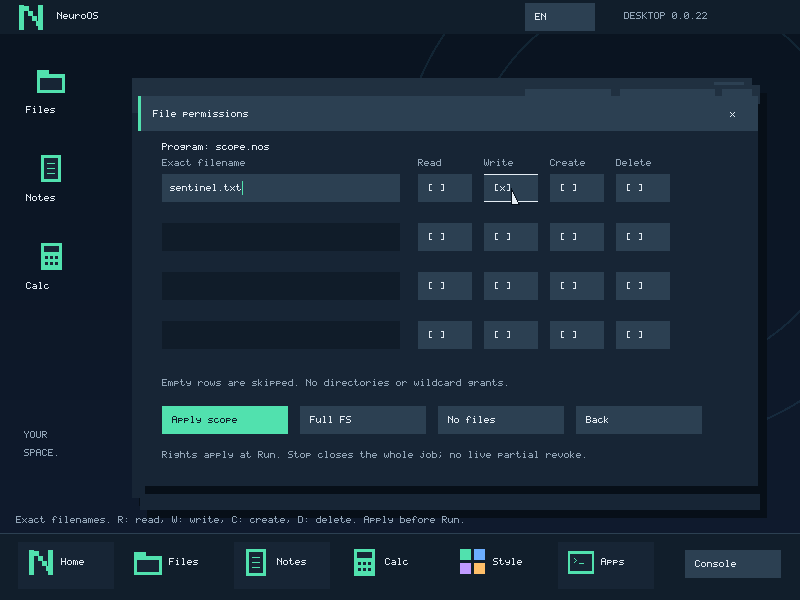
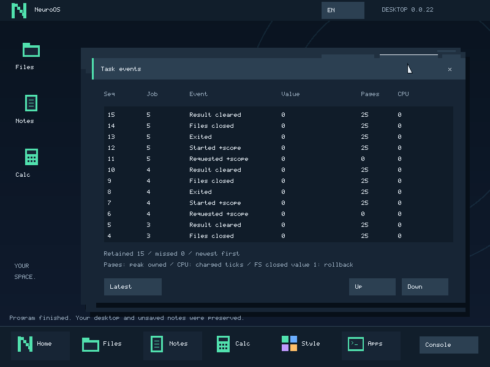

# Права на выбранные файлы — 0.0.22

Programs → Access открывает настройки для следующего запуска .nos. В четырёх
строках задаются точные имена и отдельные Read / Write / Create / Delete.
Apply scope применяет список, Full FS выбирает прежний полный доступ, No files
отключает файлы. Пустые строки пропускаются; дубликаты/неверные имена/нулевые
права отклоняются. Новое имя получает Read по умолчанию; права можно переключить.

Имена до 15 ASCII-символов: буквы, цифры, '.', '_' и '-', без точки в начале.
Это текущий плоский namespace FS3, без каталогов или wildcard. Имена чувствительны
к регистру. Стрелки вверх/вниз и Tab меняют строку, Backspace редактирует имя,
Enter применяет, Esc возвращает в Programs без применения.

Обычная кнопка file access в Programs включает/выключает выбранный режим.
После Apply она подписана Exact file scope. Во время loading/runtime настройки
зафиксированы; это не интерфейс частичного отзыва у живой программы. Stop отменяет
весь job и закрывает его сессию. Выбор другого executable сбрасывает и broad,
и scoped grant. Аргументы сами не расширяют права. Заметки/clipboard сохраняются.

## Семантика

| Право | Разрешённые действия над этим именем |
|---|---|
| Read (1) | READ и STAT: содержимое и размер |
| Write (2) | WRITE и TRUNCATE существующего файла |
| Create (4) | Создать новый пустой файл; запись требует отдельного Write |
| Delete (8) | Удалить файл; чтение и создание не выдаются |

Read не выдаёт Write. Write не выдаёт Read/Create/Delete. Разные строки не
складывают полномочия: Write для A и Read для B не позволяют читать A или писать B.
LIST, QUIT, CLIENT_CLOSED и неизвестные операции scoped клиенту недоступны.
Отказ приходит до постановки запроса в очередь FS, без побочных действий backend.

BEGIN/ABORT доступны также для read snapshot. COMMIT требует хотя бы одного
mutation right; все предшествующие изменения всё равно проверяются по именам.
Read-only клиент не может подтвердить draft. Завершение/Stop откатывают только
неподтверждённую транзакцию этого владельца. Подтверждённый commit не отменяется.
Чужая транзакция даёт busy. Одновременные независимые read leases пока не поддержаны.

Существование файла с выданным Write может проверяться без раскрытия содержимого
или размера. Для старых C helpers, которые перед записью всегда посылают CREATE,
ядро при отсутствии Create не передаёт этот CREATE в backend: делает только STAT
выданного имени. Если файл есть, клиент получает EEXIST (-17); если отсутствует —
EPERM (-1). Размер/offset/data ответа обнулены, op снова CREATE. Поэтому прежний
SDK умеет обновить существующий файл с Write, но не создать отсутствующий.
SDK и file.c сохранены: новые права работают и с прежними helpers. Замена
установленной библиотеки или выдача Create для обновления существующего не нужны.

## Управляющий ABI

Syscall20 получил append-only op START_SCOPED=4. Старые START/POLL/CANCEL/REAP,
100-byte launch_request и 2088-byte native_job_info не изменены. Размер нового
nos_scoped_launch — 188 байт: прежний launch_request с flags=0 и 88-byte file scope.
Scope: count1..4, reserved0, четыре {name[16], rights32}. Неиспользованные строки
и padding после NUL нулевые. Форматы — user/fs_scope.h и user/desktop.h.

Полный request копируется в kernel snapshot. Неверный размер/список/флаги дают
-22, недоступная память -14. Неуспешная валидация не создаёт job/событие. Только
фиксированный доверенный desktop/controller может запускать задачи; обычная .nos
не получает это право даже с четырьмя полными grants.

Scope копируется в task при exec. Kernel проверяет каждый 64-byte запрос до
общего FS endpoint. Пользователь не задаёт sender/session/reply route или private
create-probe flag. Probe хранится в metadata сообщения/FS-задачи и действует только
на связанный ответ; status/name/op/size в пользовательском payload прав не выдают.
Session ID и обратный endpoint проверяются независимо от номера slot.

Приватный loader читает только executable в своей временной роли, затем эта роль
и heap уничтожаются. Право прочитать source image не наследуется приложением.
Сбой FS и завершение владельца используют прежние cleanup/recovery без replay.
Journal format1 добавляет flag SCOPED_FILES=2 вместе с FILES=1. Events показывает
Requested/Started +scope; имена и содержимое файлов в журнал не попадают.

## Границы

Это неизменяемые grants по текущим именам, не стабильные object handles. Если файл
удалён и создан заново под тем же именем, grant относится к новому содержимому
этого имени. В текущем FS нет rename/symlinks. Отдельные handles, делегирование,
живой отзыв и срок действия прав — следующие задачи; модели здесь не нужны.

Один outstanding native job, прежние heap/CPU limits; per-file IO quotas и лимит
времени транзакции ещё не введены. Клиент с BEGIN может задерживать другие сессии
до ABORT/завершения/Stop. Kernel console и ранние драйверы пока остаются в ядре.
Full FS не является ограниченным scope: нужен, например, текущему compiler/SDK,
который читает больше четырёх headers и создаёт выходные файлы. По умолчанию off.

Проверки: test_fs_policy.py — настоящий C, права/имена/каноничность и probe;
test_scoped_files.py — ring3 клиенты, immutable snapshot, четыре независимых
grants, legacy helpers, запрет создания без Create, rollback/PMM/точные файлы;
test_scope_desktop.py — настоящий GUI, Read/Write, отказ записи, fixed settings,
сброс grants и сохранённая заметка. Тестовые FS3/FS2 диски отдельные от VMware.
