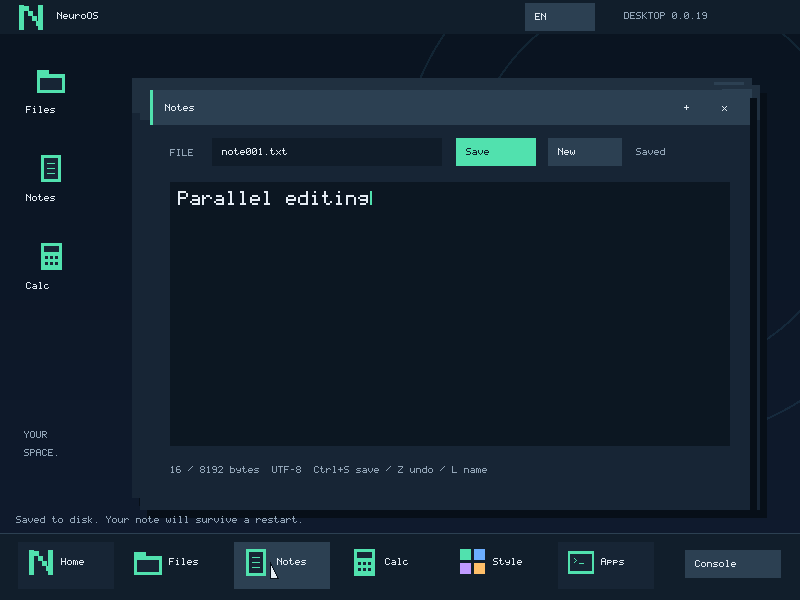

# Нативные фоновые задачи — 0.0.22

Programs запускает обычную .nos параллельно с desktop. Вывод появляется в окне;
Stop отменяет задачу. Notes/Calculator/Files продолжают принимать ввод. Файловое
разрешение выключено по умолчанию и сбрасывается при смене executable. Это один
desktop-owned job за раз; встроенные окна всё ещё принадлежат одному процессу.
На время работы настройки запуска и file grant зафиксированы; это не интерфейс
живого отзыва части прав. Enter/Esc в Programs запрашивают Stop.

С 0.0.21 чтение файла также фоновое: отдельный restricted loader, LOADING и Stop
до запуска image. На read snapshot файловый сервис может вернуть busy другим
клиентам; редактор сохраняет текст в памяти. Проверка ELF/создание mappings остаются
в ядре. Семантика, private ABI и ограничения — [loader.md](loader.md).

С 0.0.20 lifecycle также наблюдается через независимый read-only journal(21).
Programs → Events не потребляет результат POLL/REAP и не отменяет ребёнка.
Формат, значения событий и ограничения RAM-кольца — [events.md](events.md).

## Управляющий ABI

Вызов 20 принимает op, аргумент и размер. Сейчас доступен только фиксированному
доверенному desktop boot-модулю; обычные .nos не наследуют управление задачами,
display/input, ATA и model-read права. Форматы — user/desktop.h.

| op | Аргумент | Результат |
|---|---|---|
| START=0 | Указатель на 100-байтовый launch_request | Положительный непрозрачный ID или ошибка |
| POLL=1 | Writable native_job_info, 2088 байт, входной id | Текущее состояние, вывод и результат; 0 при успехе |
| CANCEL=2 | ID, размер 0 | Запрос остановки живой задачи; 0 при успехе |
| REAP=3 | ID, размер 0 | Освобождение FINISHED handle; живой job даёт busy |
| START_SCOPED=4 | 188-byte nos_scoped_launch, flags0 и список до 4 имён/прав | Запуск с правами только на эти имена и операции |

Прежний START и broad NOS_LAUNCH_FILES сохранены. Scope — snapshot до завершения,
приложение не наследует private loader role. Programs → Access задаёт отдельные
Read/Write/Create/Delete. Подробности, SDK compatibility и границы —
[file-permissions.md](file-permissions.md).

Идентификатор монотонный, не переиспользуется в течение загрузки. Исчерпание
диапазона возвращает ошибку вместо wraparound. Старый handle не управляет новой
задачей в том же слоте. POLL сначала проверяет всю writable область и входной id;
ошибочный указатель не потребляет завершённый результат. Пользовательские указатели
между вызовами не сохраняются. Второй START до REAP отклоняется.

LOADING → RUNNING → CLOSING → FINISHED → REAP. Загрузка также может перейти сразу
в CLOSING/FINISHED при ошибке/Stop. Номера прежних состояний сохранены, LOADING=4.
У .nos есть отдельные page tables, FPU state,
аргументы, heap и прежний CPU-бюджет 1000 тиков. Exit, fault, CPU limit и cancel
различаются в результате. Вывод ограничен 2047 байтами с признаком truncation.
Физические страницы ребёнка освобождаются при завершении, handle результата
сохраняется до REAP. Новый общий sleep(19) принимает 1–1000 тиков, блокирует только
вызывающую задачу и не обнуляет её потраченный CPU-бюджет.

## Логические файловые сессии

Сессия kernel broker имеет зарезервированный ID 0. Его временные fsclient.nos
процессы меняются при каждом RPC, но владелец транзакции остаётся тем же. Desktop
и обычный ребёнок получают разные положительные ID. Их нельзя установить полем
запроса: sender и обратный маршрут заполняет ядро из прав и состояния задачи.

Очередь запросов FS общая, ответы desktop и ребёнку разделены (1 и 4).
Ответ привязан также к session ID: старая сессия не может прислать ответ в новую
задачу, занявшую тот же слот/endpoint. Сейчас каждый клиент делает один RPC за
раз, FS обслуживает их последовательно. Одновременные RPC одного клиента/потоки
ещё не поддерживаются.

Одна явная FS-транзакция блокирует чужие файловые операции busy; draft скрыт.
Редактор сообщает о занятости и сохраняет несохранённый текст. После освобождения
сессии пользователь может повторить Save. Это сериализация транзакций, не MVCC.

## Отмена и закрытие

На exit/fault/cancel ядро сразу удаляет ещё не начатые запросы погибшего ребёнка
и его устаревшие ответы. Отдельное kernel-authenticated сообщение CLIENT_CLOSED
просит сервис откатить только незавершённую транзакцию этой сессии. Подделать
сообщение нельзя даже с обычным file grant: сервис принимает управление лишь
от sender 0. Подтверждение возвращается ядру, не другому клиенту.

FINISHED появляется после подтверждения закрытия, либо после изолированного
сбоя/восстановления FS. Уже выполняющаяся файловая операция может завершиться
перед обработкой отмены; подтверждённый commit не откатывается. Запросы после
ошибки автоматически не переигрываются. Неудачный cleanup отражается отдельно
от exit code приложения. При смерти сервиса supervisor выполняет новую загрузку
после сохранения desktop; предыдущая неподтверждённая запись не повторяется.

Выход из desktop отменяет его дочернюю задачу. При активном файловом сеансе
родительского завершения незавершённый сервисный контекст отбрасывается и FS
монтируется заново через прежний supervisor; восстановлены только committed roots.
Оставлять задачи после закрытия владельца пока нельзя.

Проверки без модели: test_job_control.py, test_native_background.py,
test_desktop_workflow.py, включая stale handles, неверные буферы, два клиента,
приватность/rollback транзакции, поддельный control, Stop, exit родителя и PMM.
Протокол закрытия также проверяется test_job_control.py с NEUROOS_FS_BACKEND=2.
test_native_recovery.py через GDB stub собственного QEMU ставит существующий
fault_after_io=100 и проверяет настоящий #PF файлового сервиса во время записи
фонового ребёнка, свежий mount, сохранённую заметку и отсутствие replay.
