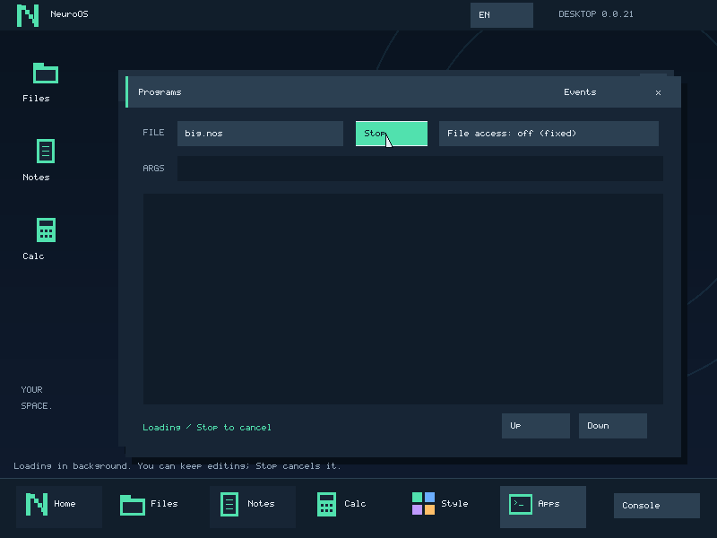
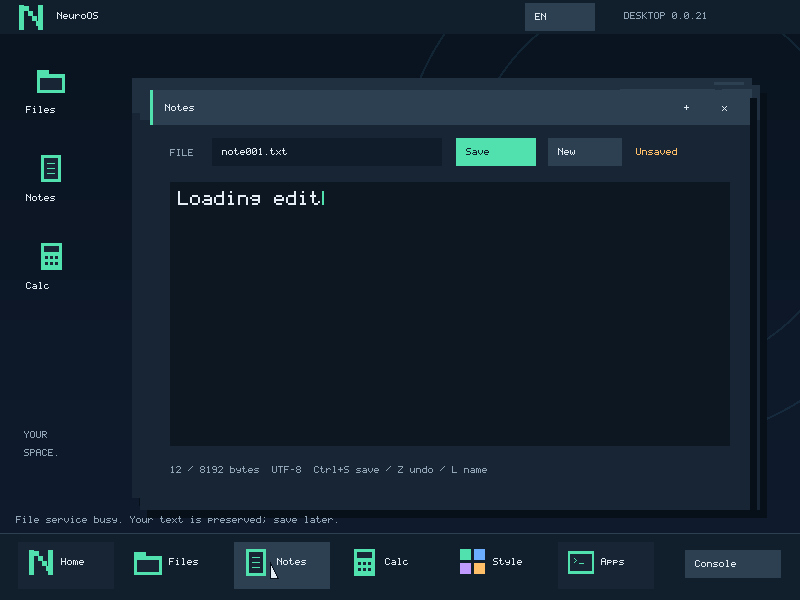

# Фоновая загрузка .nos — 0.0.21

Programs возвращает управление сразу после Start: файл читает отдельный
пользовательский loader.nos, а GUI продолжает принимать ввод. Статус Loading
переходит в Running либо результат Load error/Cancelled; Stop работает уже
во время загрузки. CLI run/runfs и совместимый syscall13 пока синхронные.

## Согласованный образ

Загрузчик открывает FS_BEGIN, проверяет размер и читает выбранный файл в свой
heap, затем выполняет FS_ABORT. Так STAT и все READ видят одну версию файла.
Неподтверждённых записей он не делает. Существующая FS сериализует транзакции:
чужой доступ, включая Save/Files, может получить busy. Notes продолжает принимать
правки, сохраняет текст в памяти и позволяет повторить Save после загрузки или
Stop. Это пока не независимые read leases/MVCC. Файл после освобождения snapshot
может измениться, но запускаются именно уже скопированные байты.

Один загрузчик на один outstanding native job, файл до 1 МиБ, временный heap
до прежних 2 МиБ. Протокол FS по-прежнему передаёт по 32 байта; новый процесс
не создаётся на каждый RPC. Нет синхронного чтения файла из kernel stack в START.
Само создание таблиц/копирование/проверка ELF пока атомарно в ядре и может кратко
занимать CPU. Это не полностью асинхронный paging/streaming loader.

## Права и замена процесса

loader.nos — отдельный доверенный boot module, appended после optional модулей,
не файл с пользовательского диска. Slot 4 получает private loader role, общую
очередь FS и свой ответ/логическую сессию. Ядро допускает только BEGIN/ABORT и
STAT/READ исходного имени; WRITE/COMMIT/CREATE/DELETE, другие имена, ATA,
display/input, запуск задач и journal недоступны. Право читать executable не
означает выдачи файлового права конечной программе.

Private syscall22: COMMIT(0, pointer, bytes) принимает 1..1048576 байт только
от этого загрузчика в LOADING. Нужен подтверждённый успешный ABORT и отсутствие
непрочитанных ответов. Проверяются все страницы источника; указатель не хранится.
Общий FS может в это время обслуживать другого клиента: глобальный idle не
является условием COMMIT уже скопированного образа. Проверяется только завершение
snapshot и очередь самого загрузчика, чтобы чужой IO не создавал ложный Load error.
Ядро копирует байты в ограниченный kernel buffer, выполняет прежнюю ELF64/NOS
проверку, создаёт отдельное адресное пространство и копирует snapshot аргументов.
Лишь после успеха переключает CR3, освобождает весь loader image/heap/таблицы
и устанавливает новую задачу без loader role. Неправильный ELF или буфер оставляет
загрузчик живым для сообщения ошибки; недействующие новые mappings уничтожаются.

Новый image получает только выбранный launch file grant, свежие регистры/FPU,
heap и CPU ticks. Job ID/owner остаются теми же: loader — фаза того же job,
а не независимая задача, которую обычное приложение может запускать/подменять.
Код конечного .nos, включая собственный compiler.nos, не может вызвать COMMIT
даже при полном доступе к FS. Проверку нельзя заменить пользовательским ELF parse.

FAIL(1, negative_errno, 0) допускает -1..-4095 и завершает loading. Неизвестный
op/размер/errno отклоняется; обычная .nos и даже desktop получают -1 до чтения
указателя. Это внутренний loader ABI, не готовый общий exec/fork API SDK.

## Ошибки, отмена и лимиты

LOADING имеет новый номер 4; прежние RUNNING=1/CLOSING=2/FINISHED=3 сохранены,
sizeof(native_job_info)=2088. START возвращает handle принятой загрузки;
ошибки отсутствующего файла/ELF наблюдаются через POLL, затем нужен REAP.

Stop, loader exit/fault или wall deadline удаляют queued requests, уничтожают
страницы и закрывают файловую сессию даже при launch flags=0. Сервис откатывает
открытый read snapshot. Выход controller также отзывает активный loader;
незавершённый FS-контекст отбрасывается, затем remount committed roots. Сбой FS
будит ожидающего загрузчика, возвращает Load error и использует прежний supervisor.
Ни один из этих путей не повторяет запрос записи и не запускает частичный образ.

Wall deadline загрузки — 6000 PIT ticks (обычно 60 секунд). Прежний user CPU
budget также действует на loader; у конечной программы новый budget 1000 тиков.
Journal: Requested до чтения, Started только после проверки и замены image.
До Started CPU/pages конечной программы равны нулю; это не счётчики временной
памяти загрузчика. Load failed хранит errno: например -8 ELF, -14 loader #PF,
-110 deadline/CPU budget, -32 разрыв FS. FS cleanup/recovery отражаются отдельно.

## Проверки

test_loader.py использует настоящий файл 1 МиБ на собственном FS3-диске, реальные
QMP/PS2 события, ввод/Save busy, Stop, повторный Save, полный запуск и exit owner
до завершения следующей загрузки. Тестовый boot probe включает production loader
и проверяет private роль, чужое имя/запись/порты, errno/op/размеры, kernel/cross-page
источник и ошибочный ELF. Рабочие boot модули восстанавливаются finally.

test_loader_failure.py заменяет только тестовые boot модули: настоящий loader
#PF с открытым snapshot, естественные 6000 ticks ожидания, настоящий mid-PIO
#PF сервиса через уже существующий fault_after_io. Ring-3 controller проверяет
точные события/ошибки, отсутствие Started, rollback/recovery и следующую запись.
PMM и исходные файлы проверены; никакой модели и рабочего диска VMware в тестах.

test_loader_busy.py оставляет реальный FS3 backend и storage, но тестовый wrapper
сервиса задерживает ответ успешного чужого STAT. Production loader через boot
probe с test-only sleep выполняет COMMIT до завершения этого ответа. Порядок
Started между Busy/Done проверен по serial, результат — exit42, страницы и файлы
прежние. До исправления общей idle-проверки этот сценарий воспроизводил отказ.
test_job_control дополнительно проверяет missing.nos (-2) и чужую открытую
транзакцию (-16): неуспешный loader не закрывает snapshot своего controller.
